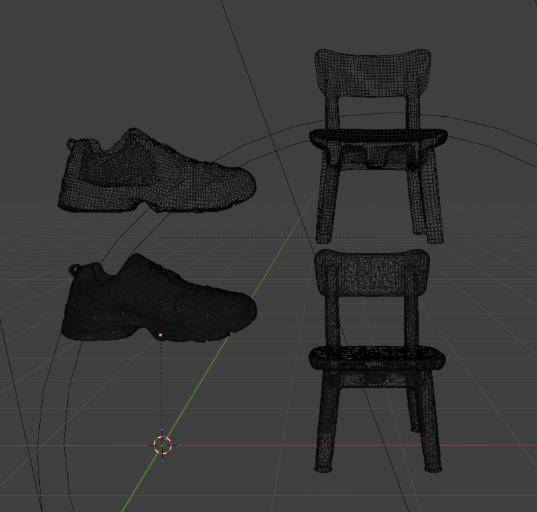
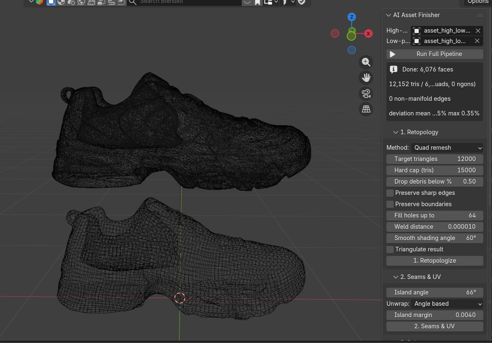
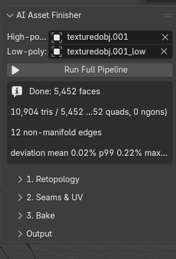

# AI Asset Finisher

**Clean quad retopology for AI-generated models and photoscans, in one click.** A Blender add-on by [CreativeLabsGTO](https://creativelabsgto.com).

AI generators (Hunyuan3D, Meshy, TRELLIS, Tripo…) and photoscans give you dense, noisy, non-manifold meshes with baked-in colour and no UVs. This add-on turns them into assets you can ship: **quads, under your polygon budget, with a few clean UV islands and the original detail baked back in.**

## What it does

1. **Clean retopology** (the headline). Cleans the mesh, removes floating debris, then remeshes with Quadriflow to a triangle budget (default 12K, hard cap 15K). If Quadriflow refuses the mesh, it rebuilds a watertight surface and tries again, and only falls back to plain decimation as a last resort. A quality report tells you triangles, quads, n-gons, non-manifold edges and the shape deviation from the original.
2. **Seams and UVs.** Angle-based seams, then merges the tiny slivers into their neighbours (a typical result is 15 to 20 islands instead of 50 to 120), with uniform texel density and packing.
3. **Bake.** Normal, base colour, roughness, metallic and AO from the high-poly into the new UVs (Cycles, GPU if available).
4. **Export.** GLB and FBX with a clean PBR material, plus the PNG maps.

The original mesh is never touched: the result is a new `<name>_low` object.

## See it

AI-generated sneaker and chair, before (dense triangles) and after (clean quads). In each picture the top object is the new low-poly, the bottom one is the original.



The same objects with the baked textures: the look of the original is kept at a fraction of the polygons.


| Wireframe | Textured |
| --- | --- |
|  |  |

The panel runs the whole pipeline with one button and reports triangles, quads, n-gons, non-manifold edges and the deviation from the original:





## Results

Measured with the headless pipeline (Blender 5.0 and 4.3):

| Input | Faces in | Result | UV islands |
| --- | --- | --- | --- |
| AI-generated sneaker, textured | 40,000 | 10,718 tris, **all quads**, 0 non-manifold edges, mean deviation 0.01% | 19 |
| AI-generated chair (thin legs) | 23,438 | 11,670 tris, **all quads**, 0 non-manifold edges, mean deviation 0.04% | 16 |
| Noisy photoscan imitation, 0.5M / 1.9M faces | 0.5M / 1.9M | about 12K tris, all quads, mean deviation 0.02% | n/a |

Limits: it targets organic and product shapes; hard-surface parts with very sharp features need "Preserve sharp edges". The UV step trades a few more islands for low stretch where a piece cannot lie flat. Tested on Blender 4.3 and 5.0 (4.2 is the declared minimum but is not tested here).

## Install

1. Download `ai_asset_finisher.zip` from the [latest release](https://github.com/NicoFromCreativeLabs/ai-asset-finisher/releases/latest).
2. Blender: **Edit > Preferences > Add-ons > ⌄ > Install from Disk**, pick the zip, enable it.
3. In the 3D viewport press **N**, open the **AI Asset** tab, pick the high-poly object, open **1. Retopology** and click **Retopologize**.

## Headless / batch

```bash
blender -b --factory-startup --python cli/optimize_asset.py -- in.glb out_dir 12000 15000 2048
```

Arguments: input mesh (GLB/GLTF/OBJ), output folder, target triangles, hard cap, texture size. It prints `[STAGE] name fraction` lines and a final `[RESULT] {json}` line, which is how our own Creativelabs 3D desktop app drives it.

## Settings worth knowing

Target triangles, hard cap, drop-debris %, preserve sharp edges / boundaries, hole-fill size, weld distance, smooth angle, triangulate, UV island angle, **max islands**, bake resolution and samples.

## Build the zip yourself

```bash
python build_zip.py   # -> dist/ai_asset_finisher.zip
```

`dev/` holds the headless test scripts (`test_retopo.py`, `test_pipeline.py`, `test_install.py`). `PLAN.md` is the roadmap.

## License

GPL-3.0-or-later, as required for Blender add-ons that use the `bpy` API. See `LICENSE`.

---

CREATIVELABSGTO · MEXICO, PARIS · <https://creativelabsgto.com>
