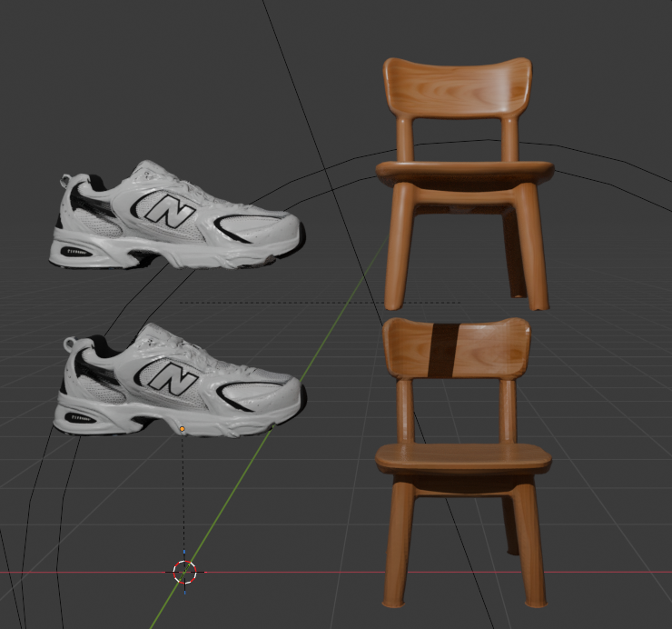
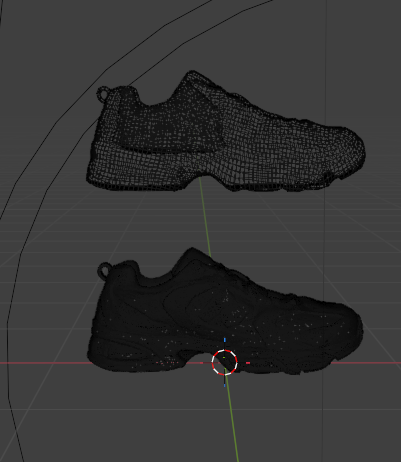
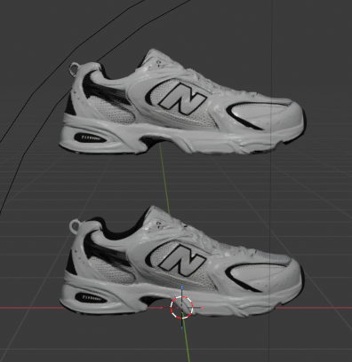

# AI Asset Finisher

**Clean quad retopology for AI-generated models and photoscans, in one click.** A Blender add-on by [CreativeLabsGTO](https://creativelabsgto.com).

AI generators (Hunyuan3D, Meshy, TRELLIS, Tripo…) and photoscans give you dense, noisy, non-manifold meshes with baked-in colour and no UVs. This add-on turns them into assets you can ship: **quads, under your polygon budget, with a few clean UV islands and the original detail baked back in.**

## What it does

1. **Clean retopology** (the headline). Cleans the mesh, removes floating debris, then remeshes with Quadriflow to a triangle budget (default 12K, hard cap 15K). If Quadriflow refuses the mesh, it rebuilds a watertight surface and tries again, and only falls back to plain decimation as a last resort. A quality report tells you triangles, quads, n-gons, non-manifold edges, the shape deviation from the original and how much of the original's detail was lost.
2. **Seams and UVs.** Angle-based seams, then merges the tiny slivers into their neighbours (a typical result is 15 to 20 islands instead of 50 to 120), with uniform texel density and packing.
3. **Bake.** Normal, base colour, roughness, metallic and AO from the high-poly into the new UVs (Cycles, GPU if available).
4. **Export.** GLB and FBX with a clean PBR material, plus the PNG maps.

The original mesh is never touched: the result is a new `<name>_low` object.

## See it

AI-generated sneaker and chair, before (dense triangles) and after (clean quads). In each picture the top object is the new low-poly, the bottom one is the original.


The same objects with the baked textures: the look of the original is kept at a fraction of the polygons.



| Wireframe | Textured |
| --- | --- |
|  |  |

The panel runs the whole pipeline with one button and reports triangles, quads, n-gons, non-manifold edges and the deviation from the original:


## Results

Measured with the headless pipeline (Blender 5.0 and 4.3):

| Input | Faces in | Result | UV islands |
| --- | --- | --- | --- |
| AI-generated sneaker, textured | 40,000 | 10,718 tris, **all quads**, 0 non-manifold edges, mean deviation 0.01% | 19 |
| AI-generated chair (thin legs) | 23,438 | 11,670 tris, **all quads**, 0 non-manifold edges, mean deviation 0.04% | 16 |
| Noisy photoscan imitation, 0.5M / 1.9M faces | 0.5M / 1.9M | about 12K tris, all quads, mean deviation 0.02% | n/a |

Limits: it targets organic and product shapes; hard-surface parts with very sharp features need "Preserve sharp edges". The UV step trades a few more islands for low stretch where a piece cannot lie flat. Tested on Blender 4.3 and 5.0 (4.2 is the declared minimum but is not tested here).

## Install

1. Download `ai_asset_finisher.zip` from the [latest release](https://github.com/NicoFromCreativeLabs/ai-asset-finisher/releases/latest).
2. Blender: **Edit > Preferences > Add-ons > ⌄ > Install from Disk**, pick the zip, enable it.
3. In the 3D viewport press **N**, open the **AI Asset** tab, pick the high-poly object, open **1. Retopology** and click **Retopologize**.

## Tutorial: from a messy AI mesh to a game-ready asset

About two minutes of work, most of it waiting for Blender.

**1. Import your model.** `File > Import > glTF 2.0 (.glb)` (or OBJ/FBX). Blender 4.3 or newer; the add-on works on a mesh with or without colours or textures.

**2. Open the panel.** In the 3D viewport press **N** and click the **AI Asset** tab. Click the **High-poly** field and pick your imported object. Leave **Low-poly** empty: the add-on creates it for you as `<name>_low`, and never touches the original.


**3. Click Run Full Pipeline.** It runs the three steps below in order and shows the progress in the panel header. You can also run them one by one with the buttons inside each section.

| Step | What it does | Settings you will actually touch |
| --- | --- | --- |
| **1. Retopology** | Cleans the mesh, drops floating debris, rebuilds it as quads with Quadriflow | **Target triangles** (12,000 default) and **Hard cap** (15,000). Lower them for mobile or web, raise them for hero assets. Tick *Preserve sharp edges* for hard-surface parts |
| **2. Seams & UV** | Cuts seams on sharp angles, merges the tiny slivers, unwraps and packs | **Island angle** (larger angle means fewer, bigger islands) and **Island margin** |
| **3. Bake** | Bakes normal, base colour, roughness, metallic and AO from the original into the new UVs | **Texture size** (1K to 8K, 2K default) and **Samples** |

**4. Read the quality report.** When it finishes, the panel tells you what you got. You want **0 n-gons**, **0 non-manifold edges** and a small **deviation** (anything under about 0.1% means the shape is faithful to the original).


**5. Check the result.** The new `<name>_low` object appears next to the original (which Run Full Pipeline hides when done, unless you untick *Hide high-poly when done* in **Output**). Switch to Wireframe (**Z**) to see the clean quad flow, and to Material Preview to see the baked textures.

| Wireframe: clean quads | Material Preview: baked textures |
| --- | --- |
|  |  |

**6. Export.** In **Output** choose a folder (or save the .blend, and it exports next to it) and a format: **GLB**, **FBX** or both. If a format is chosen before you click Run Full Pipeline, the export happens automatically; otherwise click **Export** afterwards. You get the model with a clean PBR material plus the PNG maps, ready for Unity, Unreal, Godot or the web.

**If something goes wrong**
- *Quadriflow fails or gives triangles:* the add-on already rebuilds a watertight surface and retries on its own. If the result is still not what you want, raise **Fill holes up to** or lower the target triangles.
- *Thin parts (chair legs, straps) look rough:* raise **Target triangles**, or tick *Preserve boundaries*.
- *Too many UV islands, or visible seams:* raise **Island angle**. The merge step already caps the count (16 by default; the CLI and Python API expose it as `uv_max_islands`).
- *Bake looks dirty:* raise the **Texture size** and **Samples**, then run step 3 again.

Prefer no clicking? See *Headless / batch* below.

## Headless / batch

```bash
blender -b --factory-startup --python cli/optimize_asset.py -- in.glb out_dir 12000 15000 2048
```

Arguments: input mesh (GLB/GLTF/OBJ), output folder, target triangles, hard cap, texture size. It prints `[STAGE] name fraction` lines and a final `[RESULT] {json}` line, which is how our own [CreativelabsStudio](https://github.com/NicoFromCreativeLabs/CreativelabsStudio) desktop app drives it. The CLI runs two remeshes (free flow and sharp-edge, the second in a separate Blender process with a time limit) and keeps the one that loses less detail.

## Settings worth knowing

Target triangles, hard cap, drop-debris %, preserve sharp edges / boundaries, hole-fill size, weld distance, smooth angle, triangulate, UV island angle, UV island margin, bake texture size and samples. (The island cap, `uv_max_islands`, is set from Python or the CLI.)

## Build the zip yourself

```bash
python build_zip.py   # -> dist/ai_asset_finisher.zip
```

`dev/` holds the headless test scripts (`test_retopo.py`, `test_pipeline.py`, `test_install.py`). `PLAN.md` is the roadmap.

## Generate the assets too: CreativelabsStudio

AI Asset Finisher is the optimization half of [**CreativelabsStudio**](https://github.com/NicoFromCreativeLabs/CreativelabsStudio), our free desktop app that turns a product photo or a prompt into a textured 3D asset on your own NVIDIA GPU (8 GB is enough), then runs this same pipeline on it and hands you a GLB + FBX package. Nothing is uploaded and there are no credits.

## License

GPL-3.0-or-later, as required for Blender add-ons that use the `bpy` API. See `LICENSE`.

---

CREATIVELABSGTO · MEXICO, PARIS · <https://creativelabsgto.com>
